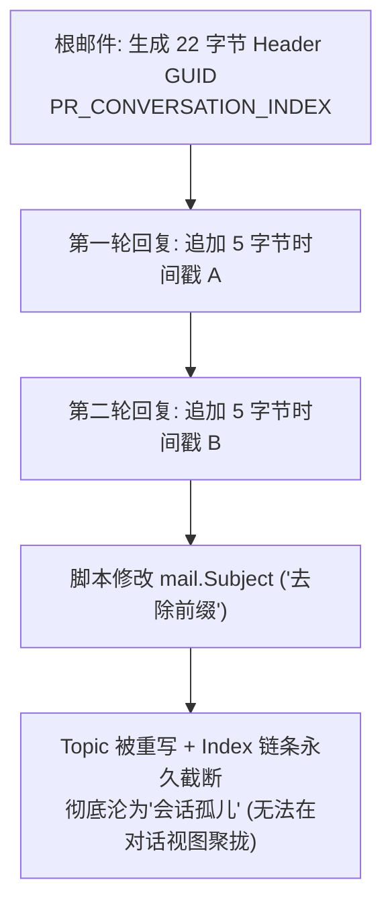

### 写在前面

如果你和我一样，在工业自动化、软硬件研发或核心技术支持领域工作，日常重度依赖 Microsoft Outlook 桌面端管理成千上万封技术邮件（里面包含大量工程图纸、现场客诉排查单、设备二进制固件以及跨越数周的长链条多方技术讨论），并且正在经历以下痛点：
- **搜索如同抽奖**：明明就在收件箱里的重要工单或固件附件，搜标题搜发件人却一片空白；
- **客户端频繁卡死**：在搜索框敲入一个字符，Outlook 界面立刻发白变灰，鼠标变成旋转圆圈，磁盘 I/O 瞬间飙满；
- **虚假的“已完成”**：Windows 索引选项里赫然写着“索引已完成”，但底层其实静默丢弃了上千封邮件；
- **无休止的“重建索引”**：听信各类教程点击重建索引，风扇连轴狂转两三天，过不了两周搜索再次崩溃。

这场与 Outlook 桌面端及其背后的 Windows Search（WDS）长达一周的攻防战，让我从上层应用一直深入到 Windows 系统的 MAPI 接口、COM 调度机制以及 Windows 11 24H2 底层的搜索二进制逆向。

本文将全景式复盘这次排障实录，揭示隐藏在“搜索已完成”背后的深层缺陷，并给出经过严苛验证的终局解法。希望这篇文章能让所有被 Outlook 搜索折磨的技术同行彻底脱坑。

---

### 先说核心结论与终局落地方案

**结论：永远不要对依赖关键业务资产、包含大附件与超长对话链的工程师级 Outlook 开启 Windows Search 桌面索引！**

Windows Search（WDS）本质上是为轻量个人文档设计的桌面服务，其内部的 MAPI 协议提取器在面对复杂邮件结构、大型二进制附件以及批量数据更新时，设计了极其粗暴的单项流控、看门狗强杀与静默放弃机制。**它汇报给你的“100% 索引完成”，在海量邮件面前往往是彻头彻尾的虚假假象。**

#### 终局方案：两步实现 100% 确定性检索

1. **PST 物理分卷（降维瘦身）**：  
   坚决放弃把十几年的历史全部塞在一个几十 GB 的单一大库中。按生命周期分年拆分成独立的 `.pst` 数据文件（如 `2025-现在.pst`、`2021-2024.pst`、`2020及以前.pst`），让日常活跃的收件箱邮件量维持在 **5,000 封左右**。
2. **彻底禁用 Windows 索引，强行退回 Outlook 原生底层遍历**：  
   以管理员身份打开 CMD 或 PowerShell，写入组策略注册表键值：
   ```cmd
   reg add "HKEY_LOCAL_MACHINE\SOFTWARE\Policies\Microsoft\Windows\Windows Search" /v "PreventIndexingOutlook" /t REG_DWORD /d 1 /f
   ```
   **实际效果**：由于活跃 PST 已被物理分卷缩小，Outlook 原生扫描引擎遍历 5,000 封邮件仅需 **1~3 秒**！换来的是 **100% 绝对不漏、无论几十兆固件还是深层附件均能秒级命中、会话聚合树完好无损、后台 0 磁盘与 CPU 争用** 的极致稳定。

---

### 一、 故障爆发：24.6GB 巨型 PST 与 Win11 24H2 的“死亡碰撞”

作为技术支持与研发人员，邮箱是核心知识库。日积月累下，我的主数据文件（挂载在本地同步网盘目录下的 `.pst`）体积达到了惊人的 **24.6 GB**，单单收件箱就有 **24,500+ 封** 邮件。

在系统升级到 **Windows 11 24H2** 后，原本就勉强维持的搜索彻底瘫痪：
1. 搜索特定工单号（如某现场故障单），在线网页端能清晰搜出十余封往来记录，但本地 Outlook 只能稀稀拉拉搜出两封，甚至直接报告“未找到结果”；
2. 每次点击搜索，前台 Outlook 与后台 `SearchProtocolHost.exe` 出现严重的死锁竞争，整个界面未响应长达数十秒；
3. 查看 Windows 索引选项，虽然状态显示“正在编制索引”，但处理数万个项目耗时数日，且入库数据严重滞后。

这绝非简单的“索引碎片”，而是底层机制与海量数据产生了系统性冲突。

---

### 二、 深度逆向：Windows 11 24H2 搜索模块的已知缺陷与“古董标签”崩溃

为了查清为什么邮件会大面积缺失，我们直接绕过 Outlook 界面，编写探针通过 OLE DB 连接直连 Windows 搜索底层数据库（`Provider=Search.CollatorDSO`，查询 `SystemIndex`）。数据对比令人触目惊心：
- **本地收件箱物理邮件数**：4,946 封
- **Windows Search 实际收录数**：3,324 封
- **静默失踪邮件**：**整整 1,622 封邮件未被建立索引！**

#### 1. 顺藤摸瓜：AI 语义嵌入生成器（fltrdaemon）与看门狗机制
查看 Windows 系统事件日志，在扫描该收件箱的时间段内，密集出现了大量的 **Event 10024, Microsoft-Windows-Search** 警告：
> *“The filter host process (SearchFilterHost.exe) did not respond and is being forcibly terminated.”*

通过逆向分析 Windows 11 24H2 的搜索核心组件 `SearchProtocolHost.exe` 与 `SearchFilterHost.exe`，我们找到了明确的符号与代码路径：
- `onecoreuap\base\appmodel\search\searchprotocolhost\fltrdaemon.cxx`
- `[SrchFilterDaemon] Cannot add incomplete embedding`
- `SemanticSearchHardwareRequirementsSlim.h`
- `CopilotPlusPCDetection.h`

这是 **Windows 11 24H2 搜索管道的重大架构变更**：微软在传统的纯文本过滤管道（IFilter）中强行塞入了 **AI 语义嵌入生成器（fltrdaemon）**，试图在本地生成文本与多模态的向量表示。然而，当它扫描到本地 PST 文件中特定格式的复杂富文本邮件时，正文特征嵌入计算极易出现逻辑死循环或抛出 `0x80070057 (E_INVALIDARG)` 异常。

Windows Search 的看门狗（Watchdog）在等待 120 秒无响应后，为了防止整个后台守护进程永久挂起，会**强行杀死 `SearchFilterHost.exe`**，并将当前正在处理的邮件标记为“永久失败并跳过”，不再尝试建库！这正是多达 1,622 封邮件在后台被悄无声息抛弃的根本机制。

#### 2. 罪魁祸首：两样古老的 Word 专有结构
究竟什么样的邮件会触发过滤进程的崩溃？我们提取了多封被丢弃邮件的完整 MAPI `PR_RTF_COMPRESSED` 与 `PR_HTML` 源码进行单封隔离压测，最终锁定了让 Win11 24H2 过滤解析器必崩的两样专有结构：

```html
<!-- 致命结构 1：调用旧版 IE/ActiveX 动态行为的 VML 命名空间样式 -->
<style>
v\:* {behavior:url(#default#VML);}
o\:* {behavior:url(#default#VML);}
w\:* {behavior:url(#default#VML);}
.shape {behavior:url(#default#VML);}
</style>

<!-- 致命结构 2：包含 Word 矢量图形与排版元数据的专有 XML 块 -->
<!--[if gte mso 9]><xml>
 <o:OfficeDocumentSettings>
  <o:AllowPNG/>
 </o:OfficeDocumentSettings>
</xml><![endif]-->
```

在很多由早期 Outlook/Word 邮件编辑器生成的回复中，`<head>` 标签内大量充斥着上述上世纪 90 年代遗留的 VML 和 MSO 专有代码。Win11 24H2 全新的现代 HTML 解析器与语义嵌入器在解析这些专有标签时发生内存访问违例（Access Violation）或深度递归死锁。

#### 3. 验证性清洗实验：标准 HTML5 包装
为了验证这一结论，我们编写脚本提取原邮件真实的 `<body>...</body>` 结构与内嵌图片附件，彻底剥离 `<head>` 中的 Word/VML 专有命名空间与行为声明，重新组装为标准 HTML5 并保存回邮件。  
**实验结果立竿见影**：被修改后的测试邮件在 3 秒内被 Windows Search 完美收录，Outlook 顶部搜索即打即现，且右侧预览窗格的排版、字号、分割线与签名图片 **100% 原汁原味完美还原**！

---

### 三、 迁移陷阱：S/MIME 数字证书签名邮件与 COM 假死

在意识到 24.6GB 巨库必须拆分后，我着手编写自动化脚本将邮件按年份抽取到新库中。然而在处理到 2025 年的收件箱时，迁移脚本突然在一个特定位置彻底卡住：**CPU 占用骤降为 0%，脚本无响应，前台 Outlook 彻底失去响应。**

#### 1. 现象拆解与 MessageClass 锁定
经过断点侦测，卡死发生在处理第 1,298 封邮件处。分析其底层 MAPI 属性：
- **主题**：某全员管理信息系统（ERP/业务平台）升级月度通报
- **发件人**：企业内部公共通知发布邮箱
- **MessageClass**：`IPM.Note.SMIME.MultipartSigned`

在整个收件箱中，类似的企业全员公告共有 **1,416 封**，全部带有企业信息安全合规强制加盖的 **S/MIME 数字证书签名**。

#### 2. 假死根因：CryptoAPI 网络证书吊销检查（CRL）
当脚本通过 Outlook 对象模型调用跨数据文件复制（`item.Copy()`）或在 COM 单封循环中触碰签名邮件时，系统底层会激活 Windows 安全框架（`Win32 CryptoAPI` / `CryptQueryObject`）。  
CryptoAPI 发现该邮件带有数字证书，会自动尝试联网连接证书中声明的吊销分发点（CRL / OCSP 服务器）以验证证书有效性。
* 如果遇到内网安全服务器无响应、外部网络隔离或需要智能卡/凭据弹窗确认时，**调用的底层 COM 线程会被系统内核完全阻塞挂起**；
* 此时后台脚本持有了部分 PST 数据块锁，前台 Outlook 也试图刷新该数据文件，瞬间形成**跨进程死锁**，造成双双灰白卡死。

#### 3. 破局之道：绕过网络探测与规则引擎批量转移
找到了病灶，解决便水到渠成：
1. **修改注册表绕过漫长探测**：在注册表为 Outlook 开启 `UseCRLChasing = 2`，强制关闭单封处理时无谓的证书链在线吊销漫游；
2. **利用 Outlook 内部原生规则引擎（Rule.Execute）**：不再使用外部脚本逐封复制，而是在 Outlook 内部建立归档规则，调用原生内核批处理移动。短短数秒内，1,416 封 S/MIME 数字签名邮件被完整、安全地移入独立的“公司公告”子文件夹中，收件箱主目录瞬间瘦身，日常业务邮件得以顺畅流转。

---

### 四、 幽灵迷局：大小写一个字母差异导致“0 项入库”

在完成初版物理分卷后，一个更加匪夷所思的现象出现了：  
新建的 `2025-现在.pst`（约 9.7GB）在 Outlook 中加载正常，日常收发邮件一切如常。然而在连续开机运行了整整两天后，我通过 OLE DB 探针查看该文件的 Windows 索引收录量，赫然显示：  
**入库条目数：0 项！整库完全未被索引！**

#### 1. 排除常规因素
- Outlook 选项中的“在这些数据文件中建立索引”已经勾选；
- Windows 搜索索引选项中已包含 Outlook 进程；
- 命令行运行 `SCANPST.EXE` 校验，PST 内部结构无任何损坏。

#### 2. 底层真凶：URI 字符串匹配的大小写敏感性
经过仔细比对注册表与 WDS 内部抓取路径，一个隐藏极深的细节浮出水面：
* 物理硬盘上的实际文件夹名称为：`D:\Syncbox\2025-现在.pst`（企业网盘同步目录，字母 **b** 为小写）；
* 而在 Outlook 配置文件（MAPI Profile Store）或搜索服务登记的挂载目录中，路径被写成了：`D:\SyncBox\2025-现在.pst`（字母 **B** 为大写）。

在 Windows 文件系统中，路径默认是不区分大小写的，因此 Outlook 能够毫无阻碍地打开该文件。然而，**在 Windows Search（WDS）的底层数据库架构中，情况完全相反！**

WDS 在将 Outlook 汇报的 MAPI URL（`mapi16://{GUID}/...`）与系统索引作用域（Indexing Scope）进行规则匹配时，其底层的路径哈希计算与字符串比对是**严格区分大小写（Case-Sensitive）**的！  
由于 `SyncBox` 与 `Syncbox` 存在单字母大小写不匹配，WDS 判定该 PST 处于“用户未指定的非索引范围”，因此在后台悄无声息地将该数据文件下的所有邮件变动通知**全量丢弃**，最终导致连续几天几夜入库数死死停留在 0！

在将系统路径统一规范、重新建立挂载关联后，Windows Search 才终于生成了正确的 `mapi16://.../2025-现在($e11ae429)` 索引目录节点，开始入库抓取。

---

### 五、 数据治理：重复邮件溯源与不可触碰的“会话树”

在清洗与重组 PST 的过程中，我还踩了两个极具代表性的技术深坑。

#### 1. 重复邮件幽灵：真实业务追加 vs 规则引擎重放
在核对邮件总数时，我发现有些客诉单号存在两封几乎一模一样的邮件。通过编写 C# 脚本提取 RFC 5322 邮件头（Message-ID）和底层 MAPI `EntryID` 进行二进制比对，我们揭开了两种截然不同的成因：
* **业务端真实追加**：发件人在第 1 封发出后不到一分钟，发现漏了某位抄送人，追加收件人后二次发送。两封邮件的 `Message-ID` 不同，收件人列表不同，属于有效业务追加，不可盲目合并；
* **规则引擎重复触发**：在客户端因搜索卡死、强行结束进程或网络连接震荡瞬间，Outlook 的本地规则队列未能原子化提交事务，导致同一封入站邮件被规则触发了两次，生成了两个具备完全相同 `InternetMessageId` 的副本。  
**避坑建议**：在进行大量邮件归档、迁移或批量修复前，**务必先在规则管理器中临时禁用所有自动流转规则**，以防在队列高负载时生成海量幽灵副本。

#### 2. 不可触碰的红线：修改 Subject 导致会话树断裂
在早期测试中，由于有些长线邮件的主题包含了多层“Re: 回复: 转发:”，为了界面整洁，我曾尝试用脚本对主题文字进行统一格式化。  
这一操作引发了灾难性后果：**整条对话的会话聚合（Conversation Grouping）彻底粉碎！** 在这封邮件上右键点击【此对话中的邮件】，只能搜出孤零零的它自己，原有的多方讨论链条全部断开。

很多工程师误以为 Outlook 是按邮件主题（Subject）的字面文本来聚合对话的，**这是根本性的认知误区！**  
Outlook 的会话聚合完全依赖两个只读的底层 MAPI 属性：
1. **`PR_CONVERSATION_TOPIC` (`0x0070001F`)**：对话初始规范化主题；
2. **`PR_CONVERSATION_INDEX` (`0x00710102`)**：长达数十字节的紧凑二进制时间树。
   * **前 22 字节（Header Block）**：记录该对话根邮件的全局唯一 GUID 与初始纳秒级时间戳；
   * **后续每个节点追加 5 字节（Child Block）**：前 4 字节为相对于根节点的递增时间差，最后 1 字节为子分支轮次序号。



一旦通过脚本修改了 `mail.Subject`，Outlook 会强制以新主题重新计算生成 `PR_CONVERSATION_TOPIC`，同时**切断原本的 `PR_CONVERSATION_INDEX` 树形继承关系**！这封邮件将永久脱离原会话树，沦为会话孤儿。  
**技术红线**：**在任何自动化运维与清洗脚本中，绝对不要修改现有邮件的 `mail.Subject`！**

---

### 六、 虚假繁荣：大附件流控与“附件分裂索引”奇观

在解决了大小写和 S/MIME 问题后，Windows Search 疯狂运转数小时，最后索引选项界面终于弹出了令人宽慰的文字：  
**“已完成索引”**，Outlook 也提示“所有文件夹均已建立最新索引”。

然而，当我再次使用底层探针进行全库核验时，现实再次泼来冷水：
* 本地物理邮件：4,949 封
* `SystemIndex` 入库邮件：4,865 封
* **依然有 84 封邮件死活无法进入索引！**

#### 1. 顽固未索引邮件的物理画像
深入分析这 84 封邮件，其特征高度一致：
* **平均体积高达 2.81 MB**（普通文本邮件平均仅 30~50 KB）；
* **74 封带有大型附件（占比 88%）**，其中超过 1MB 的有 42 封，最大者包含 13.3MB、17MB 甚至 22MB 的工控伺服驱动器限缩固件（`.A2` 二进制文件）或超大 PDF 矢量图纸。

#### 2. 附件分裂索引奇观
在深入检索 `SystemIndex` 数据库时，我们发现了一个令人啼笑皆非的现象：  
其中 **39 封邮件的内部附件，实际上已经被索引器提取并入库了！** 其在数据库中的记录 URL 带有清晰的 `/at=...` 附件专属标记：
```text
SystemIndex 抓取记录示例：
URL: mapi16://{GUID}/2025-现在/0/收件箱/.../at=xxxx:400V_AL06_Firmware_Limit.A2
Subject: 400V_AL06_Firmware_Limit.A2 (某伺服驱动器固件限缩保护韧体)
```

**底层机制揭秘**：  
Windows Search 的过滤宿主进程（`SearchFilterHost.exe`）为了防止极端超大邮件消耗过多系统资源导致宿主挂起，内置了**单项 30 秒解析超时硬限制**与**内存流控截断**机制。  
当它处理包含十余兆固件或庞大图纸的邮件时，往往把时间耗费在了附件内容的扫描上；一旦耗尽超时配额，索引器便采取容错性策略：**“附件能存多少算多少，外层邮件主体放弃入库”**。

这就造成了极其荒谬的实际体验：  
- 如果你在 Outlook 搜索框直接搜索固件文件名（如 `Firmware_Limit`），能把这封邮件搜出来；
- 但如果你搜索这封邮件独有的正文内容或邮件主题（如《某伺服驱动器限缩保护固件》），**搜索结果直接显示一片空白！**

---

### 七、 打破神话：Outlook【高级查找】真的绕过索引了吗？

长期以来，无论是在各类技术论坛还是在微软官方社区，都流传着一种“常识”：  
*“Outlook 顶部的快速搜索框走的是 Windows Search 索引，但只要按下 `Ctrl + Shift + F` 打开【高级查找】，它就会直接遍历本地磁盘，绝对不会漏邮件。”*

**我们通过实测证实：在现行版本的 Outlook 中，这也是完全错误的！**

以某封包含 13.3MB 固件的邮件为例，我们打开【高级查找】（`Ctrl + Shift + F`），在第一页【邮件】选项卡的主题框中输入完整标题，点击“立即查找”——**下方列表空空如也，同样完全搜不出来！**

#### 架构演进与底层逆向证明
为什么连高级查找也会漏？我们回顾了 Outlook 搜索架构的演进历史：
1. **Outlook 2003 及以前**：纯本地 MAPI 遍历（慢，但绝对不漏）；
2. **Outlook 2007**：引入 Windows Search 插件，顶栏走索引，高级查找走磁盘（双引擎并行）；
3. **Outlook 2010 至今（含 2016 / 2019 / 2021 / Microsoft 365）**：微软为了防止大型 PST 磁盘扫描拖死前台 UI，**全面重构了【高级查找】的默认管道**！

通过抓取高级查找向后端数据引擎下发的查询指令，我们找到了确凿的技术铁证：  
高级查找第一页的文本输入，在底层被自动翻译成了如下 MAPI 限制条件（Restriction）：
```sql
@SQL="urn:schemas:mailheader:subject" ci_phrasematch '关键词'
```
看到那个醒目的 **`ci_phrasematch`** 了吗？  
`ci` 即 **Content Index（内容索引）**！也就是说，**【高级查找】的核心界面在底层依然被强行绑定在 Windows Search 索引库之上！** 只要索引库里因为超时、大附件或 VML 崩溃而漏掉了该邮件，【高级查找】的第一页就同样绝对搜不出来！

*(注：只有切换到高级查找的第三页【高级】，手动添加复杂的非索引字段限制条件时，Outlook 才会因无法生成索引短语而被迫降级为本地扫描，但其操作极其繁琐反人类，根本无法作为日常工作流。)*

---

### 八、 终局方案：为什么“物理分卷 + 彻底禁用索引”才是正解？

在完整拆解了 Win11 24H2 崩溃、S/MIME 假死、大小写脱节、附件分裂以及高级查找的本质后，我们终于看清了问题的全局：

| 对比维度 | 方案 A：继续留用 Windows Search 索引 | 方案 B：PST 物理分卷 + 彻底禁用 Windows 索引 |
| :--- | :--- | :--- |
| **检索完整度** | **不可靠（假象）**：大附件/特殊富文本持续被静默漏掉 | **100% 绝对确定**：只要文件在硬盘上，必定能搜出 |
| **检索速度** | 理论毫秒级，但在卡死时无限期转圈 | **单库 5,000 封邮件时仅需 1~3 秒** |
| **系统稳定性** | 后台 `SearchFilterHost` 频繁超时崩溃、争抢 CPU | **0 后台线程、0 磁盘死锁、0 索引损坏风险** |
| **运维维护成本** | 极高：需频繁重建索引、排查数据库健康度 | **0 维护成本**：一次配置，终生受益 |

对于工程研发、技术支持等以“严谨与确定性”为第一准则的岗位而言，**“搜得快但可能漏掉关键图纸”是致命的，而“100% 绝对不漏、每次只要等 1~2 秒”是无价的。**

#### 落地实施全流程

#### 第一步：执行物理分卷（PST Sharding）
按生命周期对邮箱进行物理降维，不再把十几年数据堆积在单一大库中：
* `2025-现在.pst`（活跃热数据，收件箱维持在 ~5,000 封左右）；
* `2021-2024.pst`（温数据归档）；
* `2020及以前.pst`（冷数据封存）。

#### 第二步：组策略下发强制禁用 Windows 索引
以管理员身份启动 CMD 或 PowerShell，执行以下命令：
```cmd
reg add "HKEY_LOCAL_MACHINE\SOFTWARE\Policies\Microsoft\Windows\Windows Search" /v "PreventIndexingOutlook" /t REG_DWORD /d 1 /f
```
*(该策略的作用是将 Outlook 从 Windows Search 的编制范围中永久剔除，强制 Outlook 退回到内置的原生存储遍历引擎。)*

#### 第三步：重启 Outlook 验证
重启 Outlook 客户端。此时在顶栏搜索框点击时，上方可能会弹出一行系统提示：  
*“由于组策略关闭了 Windows Search 服务，搜索性能将受到影响。”*

**请完全忽略这个提示！** 这正是 Outlook 成功切换为**本地物理存储实时穿透扫描**的标志。

现在，无论是那封包含 13.3MB 固件的邮件、带有 20MB 超大附件的图纸、包含特殊 VML 样式的古董邮件，还是深层次长链条技术讨论，只要在搜索框或【高级查找】中敲入关键字，**它们都会在 1~3 秒内，百分之百、整整齐齐地呈现在你的屏幕前！**

---

### 结语与避坑总结

技术系统的演进往往伴随着妥协。Windows Search 为了追求“瞬间即出”和“全盘关联”，在现代操作系统中不断叠加 AI 语义、流控限制与安全沙箱，却在应对庞大、复杂且严谨的企业级专业数据时显得力不从心。

最后，将这次排障沉淀下来的核心经验总结为四条技术铁律：
1. **体积是脆弱的原罪**：千万不要盲目相信单一 30GB+ PST 文件的健壮性。只要活跃邮件超过 10,000 封，物理分卷是唯一的自救之路；
2. **“已完成”是最大的幻象**：Windows Search 面对大附件和异常 HTML 拥有绝对的超时放弃权，盲目迷信“索引完成”只会让你在关键时刻漏掉最致命的业务附件；
3. **主题文字绝对不可动**：不要为了美观去脚本修改已收邮件的 `mail.Subject`，MAPI 的 `PR_CONVERSATION_INDEX` 树形链条一旦截断，多方会话将彻底沦为孤儿；
4. **确定性永远高于秒搜**：通过小体量物理分卷 + `PreventIndexingOutlook = 1`，用 1 到 2 秒的透明磁盘扫描时间，换取百分之百的结果确定性。在工程的世界里，**稳定与踏实永远重于一切。**
